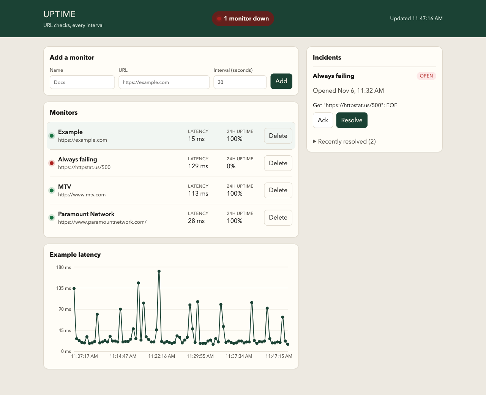
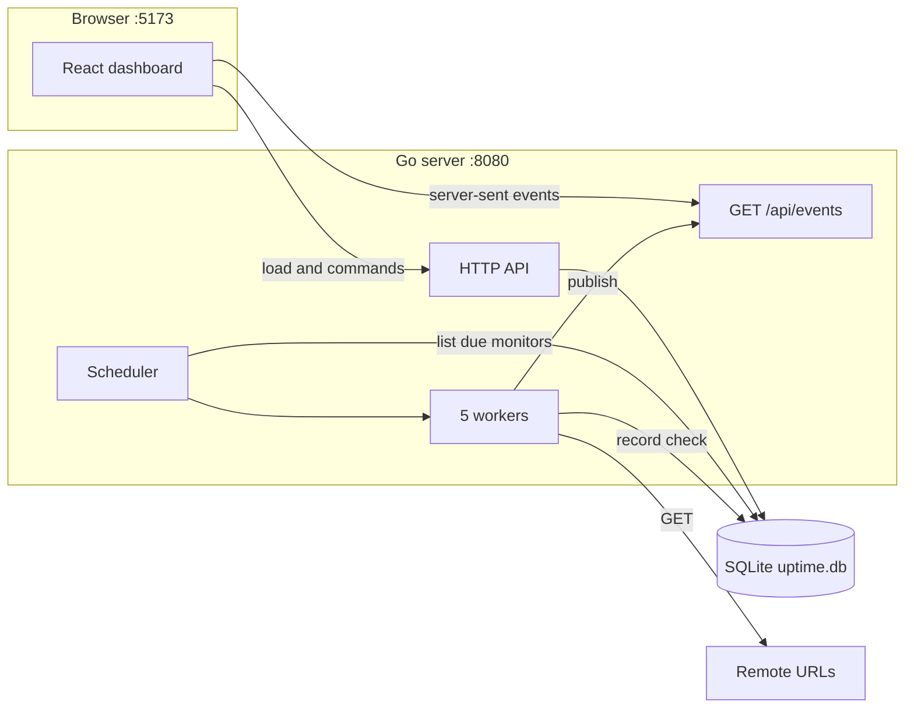

# Uptime

Uptime is a small status page for HTTP URLs. A Go server probes each URL on its own interval, stores the result, and opens an incident after three failures in a row. A React dashboard shows which monitors are up, how long the last check took, the uptime over the last 24 hours, and the incidents that are still open.

It is a local tool. There is no login. The API allows the dashboard at `http://localhost:5173` to call it.



## What you see

The header says **All operational** when every monitor's latest check succeeded, or **N monitors down** when some did not. A monitor that has never been probed is **unknown**. Unknown is gray and is not counted as down.

Each row shows the name, URL, a status dot, the last latency, and the 24 hour uptime. Click a row to plot recent latency. Delete asks for confirmation, then removes that monitor and its checks and incidents.

The incident panel lists open and acknowledged outages, with the monitor name, when it opened, and the last error. **Ack** is shown only while the incident is open. **Resolve** closes an open or acknowledged incident. Recently resolved incidents sit in a collapsed list, up to ten of them.

The page opens one live connection to the API. When a probe is stored, or an incident opens or changes, the server pushes an event and the page reloads its lists. It does not paint the event body itself, so the 24 hour uptime stays in step with the database. The header clock (`Updated …`) moves on each successful refresh, which is when a check finishes. Seed monitors run every 30 seconds, so the clock and the chart stay still between probes.

Add, delete, ack, and resolve refresh the tab that sent the command. Ack and resolve also publish an event, so a second open tab updates too. Creating or deleting a monitor does not publish. Another tab sees that change when the next probe for any monitor is stored.

If the live connection drops, the browser reconnects on its own and the page shows "Reconnecting to live updates" until it is back. A failed reload keeps the last data on screen.

## How a check works

One scheduler goroutine wakes about once a second, reads the monitor list from SQLite, and sends due monitors to a pool of 5 workers. A new monitor is due immediately. After a probe, the next one for that monitor is scheduled `interval_seconds` later. A monitor removed from the database is dropped from the schedule, so a reused id is not delayed by the previous row.

Each probe is an HTTP GET.

- The request times out after 5 seconds. That timer is not cancelled by Ctrl+C, so a probe that has already started is allowed to finish. Shutdown still cannot wait longer than that timeout.
- Redirects are not followed. A 301 or 302 is stored as the result. Status codes from 200 through 399 count as success. 400 and above count as failure.
- The client reads at most 4 KiB of the body and discards it, so a large page does not have to be downloaded for the status line to count.
- A connection error, a timeout, or an empty reply is still a stored check. `success` is false, `status_code` is 0, and `error` holds the transport message.

Workers log each result. The same worker then writes the check and applies the incident rules in one database transaction.

## Incidents

An incident is one outage for one monitor.

| Status | Meaning |
| --- | --- |
| `open` | Three failures in a row, and nobody has acknowledged it. |
| `acked` | Someone pressed Ack. It is still an active outage. |
| `resolved` | The URL recovered, or someone pressed Resolve. |

Rules:

- Three consecutive failed checks open an incident. A success in the middle resets the streak.
- While an incident is open or acknowledged, further failures update `last_error` and do not open a second incident.
- A successful check resolves an open or acknowledged incident and sets `resolved_at`.
- Ack is allowed only from `open`. A second ack, or an ack of a resolved incident, returns 409.
- Resolve is allowed from `open` or `acked`. Resolving an already resolved incident returns 409.
- After a resolve, only checks newer than that `resolved_at` count toward the next streak. Three new failures are required.

The first time the database is empty, the server inserts two monitors, both on a 30 second interval:

| Name | URL | What to expect |
| --- | --- | --- |
| Example | `https://example.com` | HTTP 200. Stays up. |
| Always failing | `https://httpstat.us/500` | Meant to fail. On some networks the host closes the connection with no HTTP response, so the stored check has status 0 and an error containing `EOF`. That is still a failure, and it still opens an incident. |

A later start does not insert them again. Monitors you add in the dashboard are kept.

## Architecture



```text
go-uptime/
  backend/
    cmd/server/main.go          process entry: config, HTTP server, checker
    internal/monitor/           monitor, check, and incident types, plus the incident rules
    internal/checker/           scheduler and worker pool
    internal/events/            in-memory pub/sub for live updates
    internal/store/             SQLite schema and queries
    internal/api/               routes, validation, CORS, request logs, event stream
    go.mod
  frontend/
    src/                        React dashboard
    .env                        VITE_API_BASE_URL
  README.md
```

`internal/` is compiler-enforced privacy. Only `cmd/server` is a `main` package. The incident decision is a pure function in `monitor`. The store is the only package that writes SQL. The checker does not import the database. After a probe it calls the callback that `main` wired to `RecordCheck`.

## Technologies

**Backend**

- Go 1.26. The module file is `backend/go.mod`, module path `uptime-monitor`.
- The standard library only, for HTTP, JSON, logging, and SQL. Routes use the Go 1.22 method-and-path patterns (`GET /api/monitors/{id}/checks`). There is no web framework and no ORM.
- `log/slog` for request lines and probe lines. The logger is passed into the packages that need it.
- `modernc.org/sqlite`, a pure Go SQLite driver, so the server builds without cgo. The direct module is `modernc.org/sqlite v1.61.1`.

**Frontend**

- React 19 and TypeScript, built with Vite 8.
- Recharts for the latency line.
- Plain CSS. No component library.
- oxlint for linting.

**Browser to API**

The dashboard's base URL is `VITE_API_BASE_URL` in `frontend/.env`, defaulting in code to `http://localhost:8080`. Vite is pinned to port 5173 (`strictPort`), which is the only origin the API's CORS middleware allows. Methods allowed: `GET`, `POST`, `DELETE`, `OPTIONS`. Headers allowed: `Content-Type`, `Accept`.

## Requirements

- Go 1.26 or newer. Check with `go version`.
- Node.js and npm. The dashboard was built with Node 25 and npm 11. Current Node 20+ is enough for Vite 8.

## Run it

Use two terminals. Start the API first.

```bash
cd backend
go run ./cmd/server
```

You should see a `listening` line with `addr=:8080` and `db=uptime.db`. The first run also logs `seeded monitors`. Leave this process running.

```bash
cd frontend
npm install
npm run dev
```

Open http://localhost:5173.

`uptime.db` is created in the directory you started the server from. Started from `backend/`, the file is `backend/uptime.db`. Database files are gitignored.

Stop the server with Ctrl+C. It stops scheduling new probes, waits up to 6 seconds for probes already running, closes every live event stream, then shuts the HTTP server down with a 5 second limit. The database closes after HTTP has stopped. A second Ctrl+C stops the process immediately.

### Environment

| Variable | Default | Used by |
| --- | --- | --- |
| `ADDR` | `:8080` | API listen address. |
| `DB_PATH` | `uptime.db` | SQLite file. A relative path is resolved from the working directory of the server process. |
| `VITE_API_BASE_URL` | `http://localhost:8080` | Dashboard. Set in `frontend/.env`. A trailing slash is stripped. |

Example, API on another port:

```bash
cd backend
ADDR=:8099 DB_PATH=/tmp/uptime.db go run ./cmd/server
```

Point the dashboard at the same port by editing `frontend/.env`, then restart `npm run dev`. The browser origin must stay `http://localhost:5173`, because that origin is fixed in the API.

### Production build of the dashboard

```bash
cd frontend
npm run build
npm run preview
```

`npm run build` typechecks with `tsc -b`, then writes `frontend/dist`. `preview` serves that build. The dev server on 5173 is what CORS is set up for. A preview server on another port will be blocked by the browser until the API's allowed origin matches it.

## Try the API with curl

With the server on `:8080`:

```bash
curl -s http://localhost:8080/healthz
curl -s http://localhost:8080/api/monitors
curl -s http://localhost:8080/api/monitors/1/checks?limit=5
curl -s http://localhost:8080/api/incidents
curl -s -X POST http://localhost:8080/api/monitors \
  -H 'Content-Type: application/json' \
  -d '{"name":"Docs","url":"https://example.com/docs","interval_seconds":30}'
```

A created monitor is probed within about a second. `DELETE /api/monitors/{id}` returns 204 and an empty body.

## HTTP API

JSON errors look like `{"error":"..."}`. A 500 body is always `{"error":"internal error"}`. The server log has the underlying error. Request bodies are limited to 1 MiB. Unknown JSON fields are rejected.

### `GET /healthz`

`200` and `{"status":"ok"}`. This only means the process is serving HTTP. It does not ping the database.

### `GET /api/events`

A server-sent event stream. The response stays open. Each message names one of three events:

| Event | When | `data` |
| --- | --- | --- |
| `check_result` | A probe was stored | The check, including its id |
| `incident_opened` | Three failures opened an incident | The incident |
| `incident_updated` | Ack, resolve, or a new last error | The incident |

The stream starts with `retry: 3000`, so a dropped browser waits 3 seconds and reconnects. A `: keepalive` comment is sent every 15 seconds. When the client disconnects, the request context ends the handler. Shutdown closes the broker, which ends every stream, and then stops the HTTP server.

Each subscriber has a buffer of 16 events. A full buffer drops that event for that subscriber, and the probe continues. The next event, or the reconnect, causes the dashboard to reload its lists, so a dropped message is recovered from the database.

`check_result` is the saved check, including its id. Incident events from a probe are the newest incident for that monitor and omit `monitor_name`. Ack and resolve include `monitor_name`, because those handlers return the joined row. Creating or deleting a monitor does not publish an event.

### `GET /api/monitors`

Every monitor, oldest id first. `Monitor` fields are flattened with the summary fields.

```json
{
  "id": 1,
  "name": "Example",
  "url": "https://example.com",
  "interval_seconds": 30,
  "created_at": "2026-11-06T16:00:00.000000000Z",
  "status": "up",
  "last_latency_ms": 19,
  "uptime_percent": 100
}
```

- `status` is `up`, `down`, or `unknown`. It comes from the newest check of any age.
- `last_latency_ms` is that check's latency, or `null` when there is no check.
- `uptime_percent` is successful checks divided by all checks in the last 24 hours, on a 0–100 scale rounded to one decimal. It is `null` when that window is empty. A monitor can be `up` with a null uptime when its only sample is older than 24 hours.

### `POST /api/monitors`

```json
{ "name": "Docs", "url": "https://example.com/docs", "interval_seconds": 30 }
```

`interval_seconds` may be omitted. It then defaults to 30. An explicit `0` is rejected.

| Field | Rule |
| --- | --- |
| `name` | Required after trimming. At most 100 characters. |
| `url` | Required. Absolute `http` or `https` URL. At most 2048 characters. |
| `interval_seconds` | Integer from 5 to 86400, or omitted. |

`201` returns the new monitor as a summary with `status` `unknown` and null latency and uptime. Validation failures are `400` and the `error` string is the message the form shows.

### `DELETE /api/monitors/{id}`

`204` with an empty body. Checks and incidents for that monitor are deleted with it. An unknown id is `404`. A non-numeric id is `400`.

### `GET /api/monitors/{id}/checks?limit=`

Recent probes for one monitor. `limit` defaults to 100 and must be from 1 to 1000. The server loads the newest `limit` rows, then returns them oldest-first so the chart can plot left to right. A missing monitor is `404`, including after it has been deleted. An empty history is `[]`, not `null`.

```json
{
  "id": 10,
  "monitor_id": 1,
  "status_code": 200,
  "latency_ms": 19,
  "success": true,
  "checked_at": "2026-11-06T16:28:55.432849000Z"
}
```

Failed checks include `error`.

### `GET /api/incidents?status=`

Incidents, newest `opened_at` first, each joined with `monitor_name`. Omit `status` for every incident. `status` may be `open`, `acked`, or `resolved`. Anything else is `400`. An empty result is `[]`.

### `POST /api/incidents/{id}/ack`

Sets an open incident to `acked` and fills `acked_at`. `200` returns the updated incident, including `monitor_name`.

### `POST /api/incidents/{id}/resolve`

Sets an open or acknowledged incident to `resolved` and fills `resolved_at`. `200` returns the updated incident.

| Situation | Status |
| --- | --- |
| Id is missing | 404 `not found` |
| Ack of an incident that is not open | 409 `incident is not open` |
| Resolve of an incident that is not open or acknowledged | 409 `incident is not open or acknowledged` |
| Bad id | 400 `id must be a positive integer` |

## Database

SQLite file, created on startup if it is missing. One connection is used. SQLite has a single writer, and the `foreign_keys` pragma applies per connection, so one connection keeps cascades and the busy timeout consistent. `busy_timeout` is 5 seconds.

Timestamps are stored as UTC text with a fixed width (`2006-01-02T15:04:05.000000000Z`), so sorting the text sorts by time. `success` is `0` or `1`.

```text
monitors
  id, name, url, interval_seconds, created_at

checks
  id, monitor_id → monitors ON DELETE CASCADE,
  status_code, latency_ms, success, error, checked_at
  index (monitor_id, checked_at)

incidents
  id, monitor_id → monitors ON DELETE CASCADE,
  status, opened_at, acked_at, resolved_at, last_error
```

Rows in `checks` older than 24 hours are deleted once when the server starts and then every hour. Incidents are kept. The uptime percentage uses that same 24 hour window.

## Tests

Run them from `backend/`. That directory holds `go.mod`. From the repository root, `go test ./...` fails because that directory is not a Go module.

```bash
cd backend
go test ./...
go test -race ./...
```

`ok` means the package passed. `?` and `[no test files]` means that package has no tests. `cmd/server` is one of those. `(cached)` means Go reused a previous result because the inputs did not change. `-race` rebuilds, so it usually is not cached.

What the tests cover:

- Incident decisions: open on the third failure, no second incident while one is active, success resolves, a manual resolve starts the streak over, monitors do not share streaks.
- HTTP status mapping: 2xx and 3xx succeed, 4xx and 5xx fail, a 302 is not followed into a later 500, a closed server yields status 0, a short timeout contains `deadline exceeded`.
- The worker pool stops when its context is cancelled, and a monitor added while the scheduler is already running gets probed.
- Store: uptime window versus current status, seed runs once, foreign keys are on, delete cascades, check order, incident filters include the monitor name, checks older than 24 hours are pruned.
- API: validation, default interval, delete, check limits, incident ack conflict, CORS preflight for `http://localhost:5173`, the event stream delivers a check and stops when the client disconnects.
- Events: a subscriber receives a publish, a full buffer does not block the publisher, unsubscribe and close stop delivery.

Frontend:

```bash
cd frontend
npm run lint
npm run build
```

## Design notes

**Fixed worker pool.** Five workers share one HTTP client. The job channel is buffered to the pool size, so a slow URL holds a worker and slows the scheduler once the buffer is full, instead of starting an unbounded number of requests. The scheduler is one loop that re-reads the database, so creating or deleting a monitor takes effect without a restart.

**SQLite and one connection.** The data is one file, with no separate database process. The tradeoff is throughput: checks and API queries share that connection, and a query must finish, including closing its rows, before the next one starts. That fits a local monitor with a handful of URLs. A busier deployment would want a server database and a connection pool.

**Live updates.** The dashboard keeps one `EventSource` open to `GET /api/events`. The server pushes a check or an incident change, and the page reloads its lists. The browser reconnects by itself after a drop. WebSockets would also push updates, and would let the browser send commands on the same connection. Ack, resolve, and create stay ordinary HTTP requests, so a one-way event stream is enough. Reloading the lists keeps the 24 hour uptime correct. The cost is one extra read of the monitors, incidents, and the selected chart on every probe.

**Redirects.** Storing the first response makes a 3xx visible as success. Following redirects would hide that hop and report whatever the final URL returned.

**Shutdown.** The listen socket is bound before workers start, so a taken port does not launch probes and then shut them down. On SIGINT or SIGTERM the scheduler stops. Probes already running are allowed to finish, bounded by their 5 second timeout and a 6 second wait. The event broker then closes, which ends every server-sent stream. `http.Server.Shutdown` waits up to 5 seconds for any remaining HTTP handlers. The database closes after that.

## Limits

- No authentication or multi-user access.
- CORS allows only `http://localhost:5173`.
- Probes are GET only. There is no request header, request body, or TLS option per monitor.
- The health check does not report database failure.
- A second dashboard tab does not hear create or delete until the next stored probe.
- A subscriber that does not read within 16 events drops the ones it missed. The dashboard recovers by reloading on a later event.

## Future work

These are the changes that follow from the limits above.

**Notify when an incident opens.** The broker already publishes `incident_opened`. A subscriber in the server process could send mail or a Slack message. The dashboard would stay a viewer.

**Patch the dashboard from the event.** The page refetches monitors, incidents, and the selected chart on every probe so the 24 hour uptime stays correct. With more URLs, the client would patch the selected chart from `check_result` and reload incidents only for `incident_opened` and `incident_updated`. Create and delete would publish their own events so other tabs update immediately.

**Richer probes.** A method, headers, a body, an expected status, and a per-monitor choice to follow redirects. Today every probe is GET, and a 3xx is stored as success.

**A deploy beyond one laptop.** A configurable CORS origin, a `/healthz` that fails when SQLite does not answer, and authentication so the API is not open on a network. Monitors would belong to a user.

**A server database.** One SQLite connection fits a handful of URLs on one machine. More monitors, or more than one API process, wants PostgreSQL and a connection pool. SQL lives only in `internal/store`, so that swap stays in one package.
